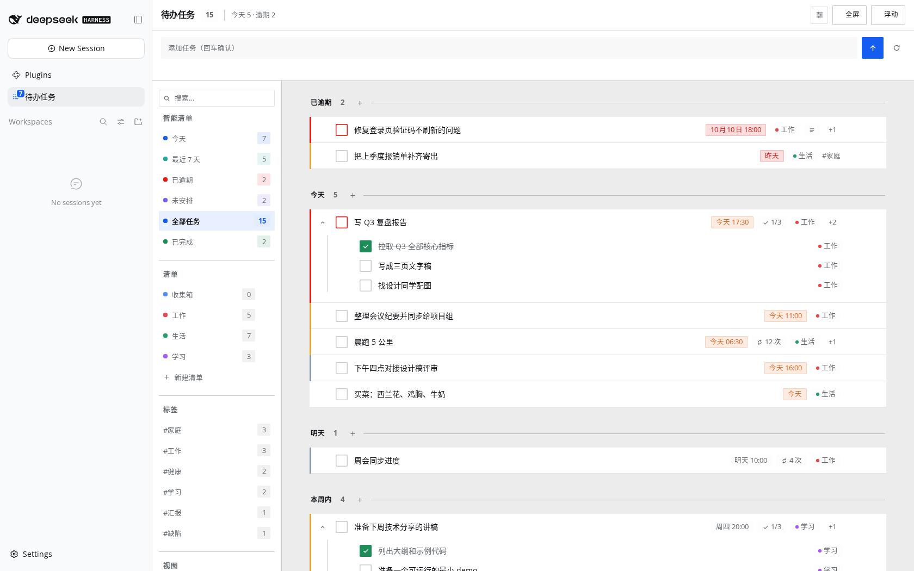
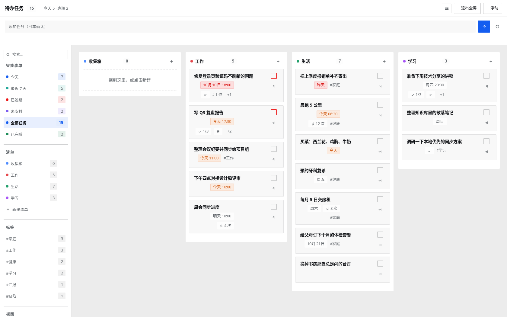
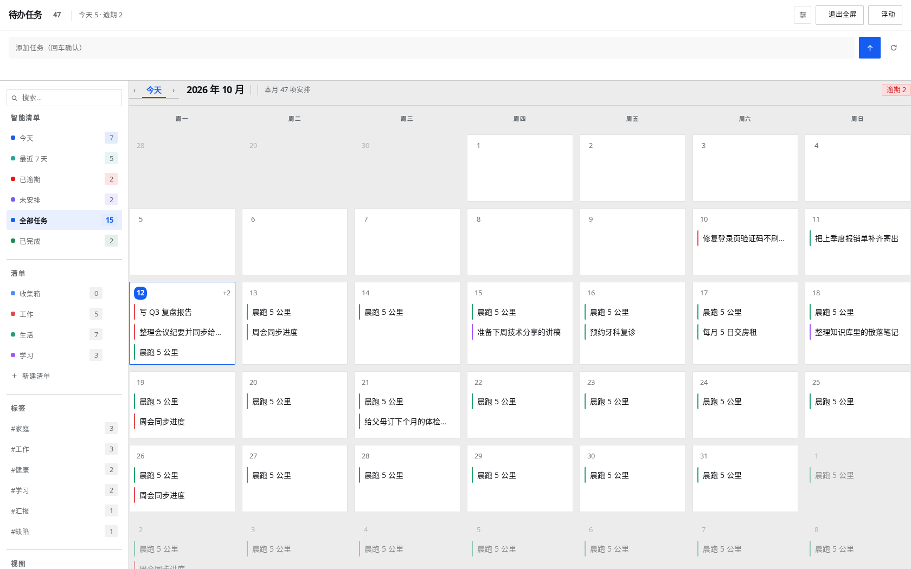
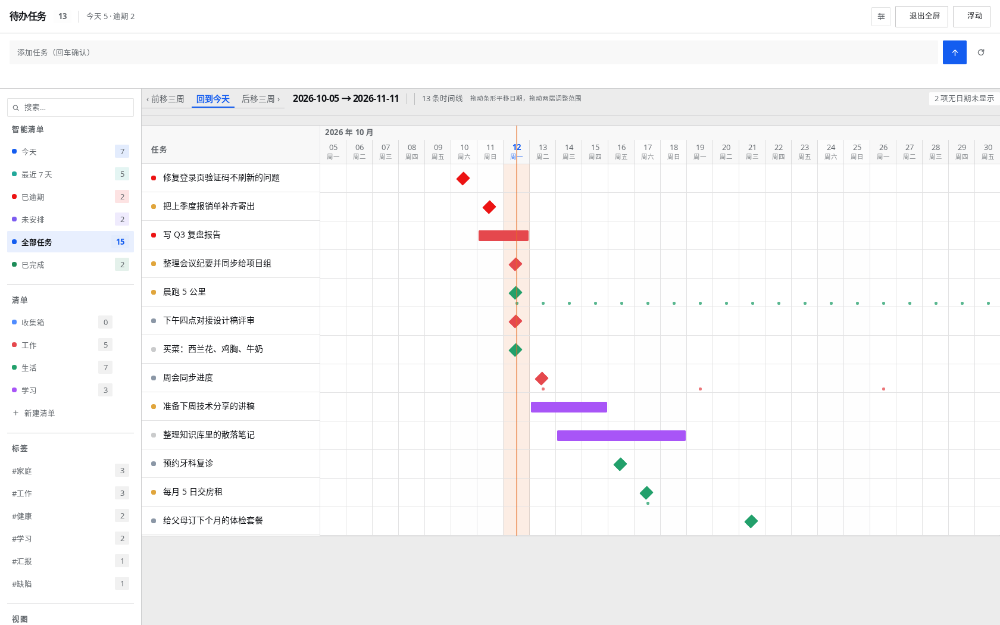
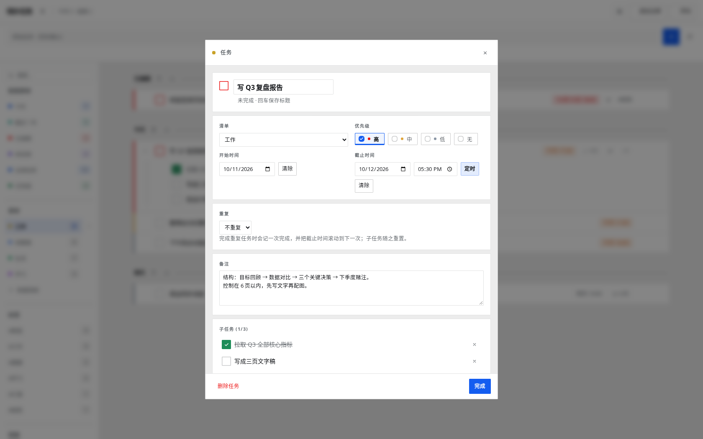
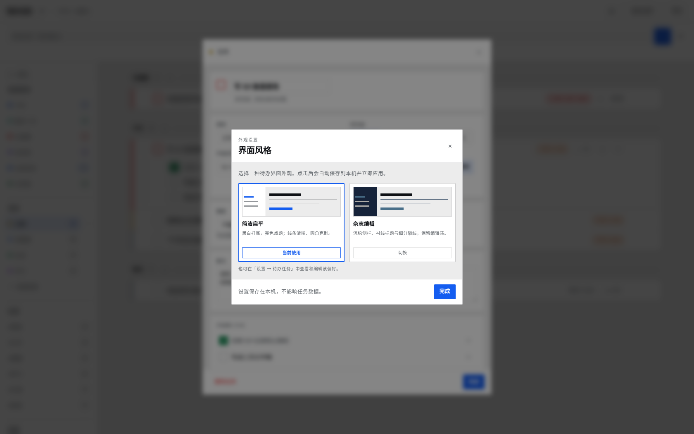
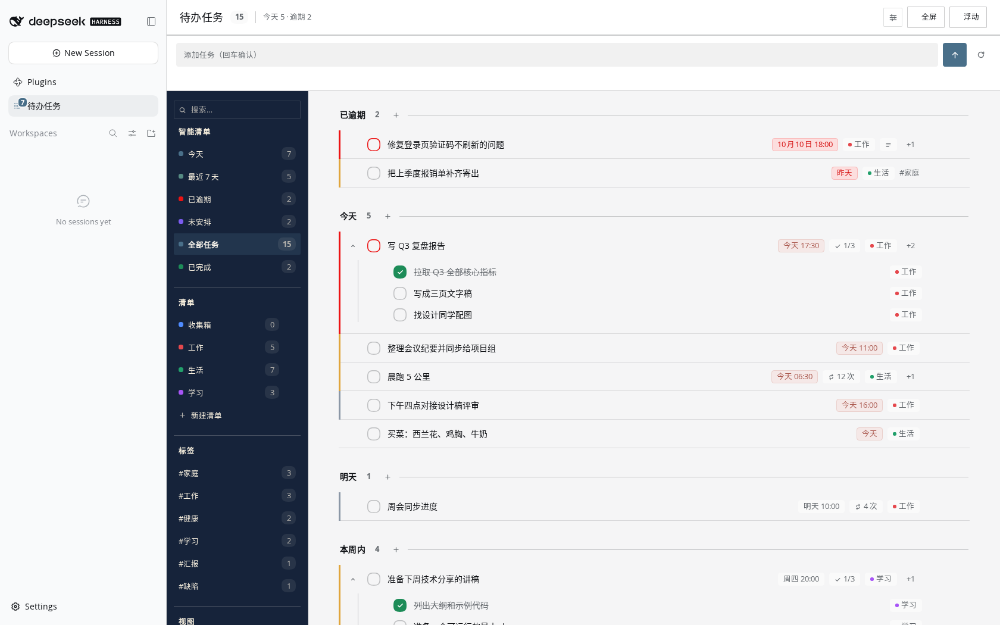
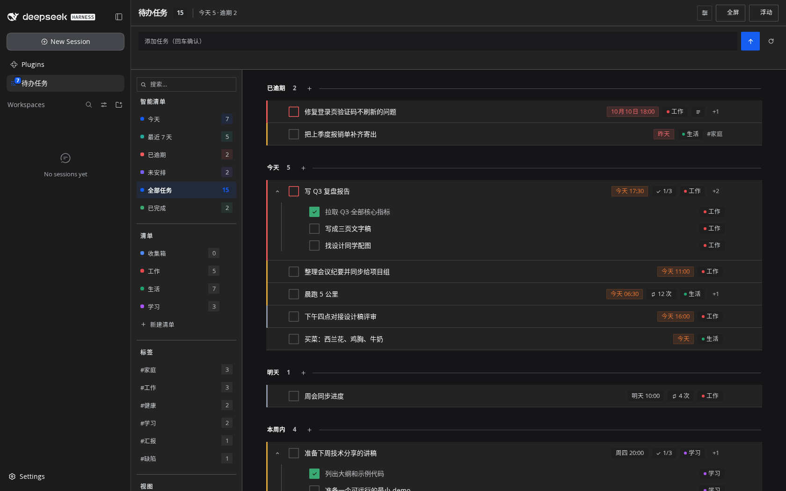
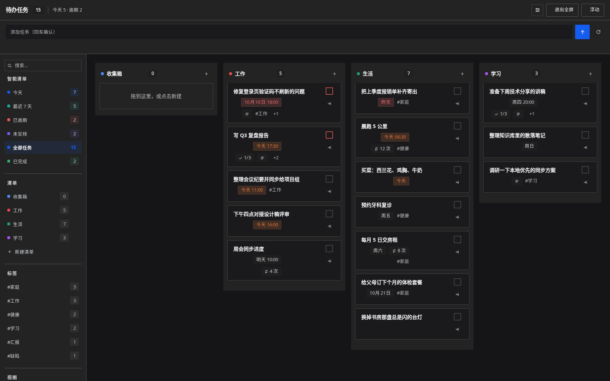
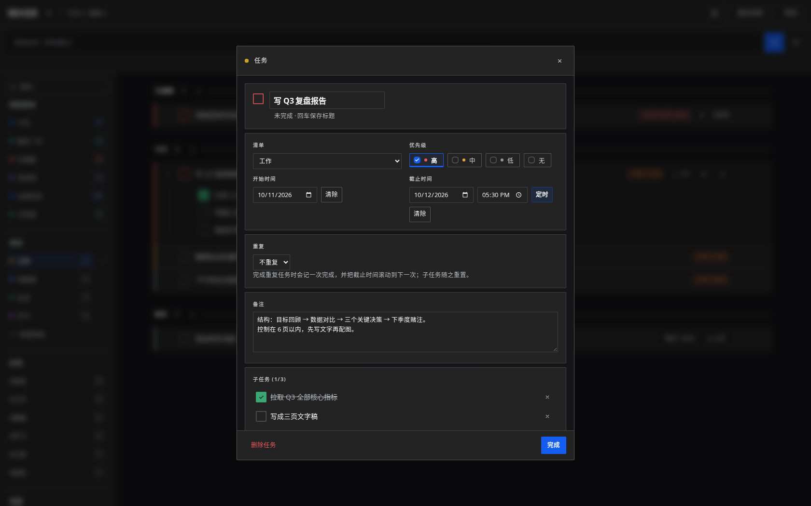

<h1 align="center">dsh-task-todo · 待办任务</h1>

<p align="center">在 DSH 里管理你的任务：四种视图、子任务与备注、每日/每周/每月重复，<br>
并且同一份数据对 agent 开放为工具与斜杠命令。</p>

<p align="center">
  <a href="./LICENSE"></a>
  <a href="https://github.com/deepseek-ai/deepseek-harness"></a>
  
</p>

---

## 它做什么

侧边栏在「新建会话」和「工作区」之间多出一个「待办任务」入口，点开即用主面板里的完整任务页；
再点一次同一个入口就收起、回到会话。同一份数据也是 agent 可读写的工具集。任务是全局的
（不是按会话分库），所以你早上加的任务，下午在另一个会话里依然在。

| 能力 | 说明 |
| --- | --- |
| 浮窗 | 一个可拖到页面任意位置、可拉伸大小的独立小窗口，专门用来一边看会话一边盯任务清单；它只放"我该看哪些任务"的控件，视图切换与清单管理仍留在面板里。详见下一节 |
| 复制任务内容和备注信息 | 在列表/看板任务的「更多操作」中，一键将任务标题和多行备注复制到系统剪贴板 |
| 复制到 DSH 对话 | 仅在浮窗任务的「更多操作」中提供；把标题和多行备注填入当前会话输入框，保留草稿、不自动发送。使用前需先切回一个 DSH 会话 |
| 四种视图 | 列表（按 逾期/今天/明天/本周/以后/未安排 分组）、看板（列 = 清单，可拖拽换清单）、日历（月网格，重复任务出现在每个发生日）、甘特图（`start` → `due` 区间，可前后翻页）。切换器在左侧栏的「视图」分组里，窄宽度下自动搬到顶栏 |
| 任务详情 | 点任意任务/子任务从屏幕正中弹出卡片（Esc、点遮罩、点 ✕ 都能关），面板和全屏用的是同一个弹窗 |
| 完成记录与后续跟进 | 勾选完成时可填写完成情况（允许留空）；如还要跟进，可同时创建一个默认 30 天后到期、与原任务关联的独立任务 |
| 子任务 | 任意层级，可折叠；每个子任务有自己的备注、优先级、截止时间 |
| 备注 | 任务与子任务都能写多行备注（列表里以图标标记，鼠标悬停看内容）；它与完成情况记录分开保存 |
| 重复 | 每天 / 每周（可指定周几）/ 每月，支持间隔（每 2 周）、结束条件（到某天 / 共 N 次）；完成一次会滚动到下一次并重置子任务 |
| 快速添加 | 一句话搞定：`明天 15:00 交周报 !高 #工作 @紧要`；输入框下方**实时显示这次回车会创建什么**（标题、截止、重复、优先级、标签、清单，清单不存在时会说明将自动创建）——识别结果来自宿主自己的解析器，所见即所得 |
| 标签 | 左栏「标签」分组列出所有用过的标签与未完成计数，点一下只看该标签；搜索框输入 `#工作` 是同一件事。标签可整体改名（改一次，所有任务跟着变）或清空 |
| 智能清单 | 今天 / 最近 7 天 / 已逾期 / 未安排 / 全部 / 已完成，带实时计数 |
| 回收站与归档 | 普通删除先进入可恢复的回收站；支持恢复、永久清除与清空。已完成任务可归档并继续搜索；回收站自动清理和完成后自动归档均由天数设置控制，默认关闭 |
| 清单管理 | 左栏每行一个清单：点齿轮（或选中该行后点）打开居中弹窗，可**改名 / 换颜色 / 上移下移 / 删除**；也能直接拖拽换位置。颜色是 8 个预设色，点一下即生效 |
| 新建清单 | 左栏「清单」分组里直接输入名字回车即建，输入框前的圆点就是它将要得到的颜色（宿主决定的，不是猜的） |
| 数据与备份 | 左侧栏「数据」分组可导出月度计划表、导出备份、导入恢复或复制数据路径 |
| 飞书多维表格同步 | 把任务镜像到飞书 Bitable；按「任务ID」匹配，重复执行幂等。字段级对账展示两侧值；共同基准保护飞书端修改，冲突需选择覆盖、反向更新或跳过。支持先预览、确认后将可还原字段更新到本地，同时保留「从飞书补洞」只新增的语义。详见 [docs/feishu-sync.md](docs/feishu-sync.md) |
| 全屏 | 覆盖整个框架的全屏模式（Esc 退出，再点入口也可收起），切换不丢当前视图与筛选 |
| 侧边栏徽标 | 入口图标右上角显示待办数（口径可在设置里切换：今天 / 逾期 / 未完成） |
| 与 agent 协作 | 10 个工具 + `/todo` 斜杠命令 + 随包分发的技能，天然可对话操作 |

---

## 浮窗

一个**可拖、可拉伸的独立小窗口**，用来一边干别的、一边把任务清单摆在眼前。

- **怎么打开**：面板（或全屏）头部点「浮动」图标；浮动后窗口右上角显示「停靠」和「关闭」图标，
  停靠就是把界面交回侧边栏面板，关闭则是收起窗口。`Ctrl+K` 命令面板里也有「浮动窗口 / 停靠回面板」。
  它挂在框架级覆盖层上，所以不会被侧边栏或面板裁切。
- **摆放**：拖头部挪位置，右下角的小三角拉伸尺寸（最小宽度 260px）。
  位置与尺寸记在浏览器本地（`dsh-task-todo:float:v1`），下次打开还在原处——不用每次都重新摆。
- **窗口里只放三件事**：顶部常驻的捕获条（和面板同一个输入框、同一份草稿与预览）、一条「浮窗栏」
  （智能清单页签：今天 / 最近 7 天 / 已逾期 / 未安排 / 全部 / 已完成，带计数，窄了可横向滚）、
  以及清单选择器（每个清单带自己的未完成数）。视图切换、搜索、清单管理、标签与数据块都留在面板里，
  所以这个窗口就是一份清单，不是第二个面板。
- **行在这里是紧凑形态**：复选框、标题（悬停看完整标题）和行尾「更多操作」菜单；没有元信息胶囊与行尾 ＋ / ×，
  不展开子任务树，行高也更小。更多操作中可将任务复制到 DSH 对话；使用前先切回一个 DSH 会话，让输入框可用。窗口只有几百像素宽时，卡片和一堆元信息会把标题挤成一个字一行。
- **跟随当前外观**：浮窗沿用已选择的「简洁扁平」「杂志编辑」或「活力闯关」风格，并跟随 DSH 的浅色 / 深色主题；
  不再另设一套固定配色。活动窗口的「停靠」按钮使用与浮动按钮相配的线性图标。
- **同一份数据**：浮窗、侧边栏面板、全屏、agent 的 10 个工具共用同一个数据文件与同一份界面状态，
  在窗口里勾完、回面板看不丢，换个座位也不丢。

---

### 界面

以下截图来自真实运行中的 DSH Web 插件界面，使用同一份示例任务数据；默认展示「简洁扁平」风格。



| 看板 | 日历 |
| --- | --- |
|  |  |

| 甘特图 | 任务详情 |
| --- | --- |
|  |  |

| 风格切换 | 杂志编辑 |
| --- | --- |
|  |  |

| 深色列表 | 深色看板 | 深色任务详情 |
| --- | --- | --- |
|  |  |  |

#### 界面风格（v0.4.23）

面板标题右侧的「界面风格设置」可以即时切换，三种风格都会自动保存在本机；也可以在「设置 → 待办任务」里编辑。默认是「简洁扁平」。版本号按 `x.y.zz` 递增，本版为 `0.4.27`。

- **简洁扁平**：黑白与中性灰打底，鲜明蓝 `#145df0` 用于主操作、选中与聚焦；压低圆角、减掉阴影，侧栏选中项不再加左边框。沿用现有任务布局。
- **杂志编辑**：深色侧栏、蓝灰强调色 `#496f89`、衬线标题与细分隔线；保留编辑式层级，但不加装饰性大标题或统计展板，常用视图、搜索和任务操作仍在手边。
- **活力闯关**：参考 Duolingo 的明亮绿 `#58cc02`、白色画布、圆润卡片、粗边框与 4px 按压阴影；完成态用浅绿，今天 / 逾期分别用橙 / 红提示，输入聚焦用蓝色光环。按压、悬停和完成反馈使用轻量微动效，并遵循系统的减少动态效果设置；不引入虚构的 XP、连胜或吉祥物资产。

三种风格都跟随 DSH 的浅色 / 深色主题，不改变任务、筛选、视图或同步行为。日历、甘特、任务详情和独立浮窗都沿用当前选中的风格；浮窗也跟随 DSH 明暗主题。甘特图支持拖动条形平移排期、拖动左右端点调整开始与截止日期；聚焦端点后可用方向键按天微调，`Shift` + 方向键按周调整。视觉参考仍是同作者的 `dsh-style-gallery`。

---

## 安装

前置：已安装 DeepSeek Harness（`dsh`，且 `dsh web` 能跑起来）或 DSH 桌面版，Node ≥ 22。
插件的 client 声明为 `platform: "web"` —— 这是宿主客户端加载器唯一接受的值，所以**同一个包
同时适用于 `dsh web` 与 DSH 桌面版**，不需要为桌面版换一份构建。

### DSH 桌面版（desktop profile）

**桌面 profile 由 Electron 应用独占管理，命令行改不动它。**`dsh plugin --profile desktop …`
会被启动器无条件拒绝：

```
error: profile "desktop" is managed exclusively by the Electron application
```

所以请在**桌面版应用内**安装：设置 → 插件（市场）→ 添加插件，填
`github:vonvonyung/dsh-task-todo#v0.4.27`（固定到本次发布）；也可以指向本地目录或本地产出的 `.tgz`。
装完**完全退出并重启桌面版**（bundle 层只在启动时读取；桌面版用自己的窗口加载客户端
bundle，不需要像浏览器那样 `Ctrl+F5`）。卸载同样在应用内的插件管理器里做。

完整步骤、验证方法与回滚见 [docs/desktop-install.md](docs/desktop-install.md)。

### Web（`dsh web`）

```sh
# 安装本次 GitHub Release（固定版本）
dsh plugin --profile web add "github:vonvonyung/dsh-task-todo#v0.4.27"

# 从 npm 安装（npm 包发布后可用；目前尚未发布到 npm）
dsh plugin --profile web add dsh-task-todo

# 或者指到本地目录（开发形态）
dsh plugin --profile web add "<插件目录的绝对路径>"
```

然后**重启 `dsh web`**：bundle 层只在启动时读取。带 UI 的插件还要
`Ctrl+F5` 强刷一次浏览器（客户端 bundle 按包路径缓存）。

卸载：

```sh
dsh plugin --profile web remove dsh-task-todo
```

### 数据文件

任务数据默认写在 **`<DSH_HOME>/todo/tasks.json`**（`DSH_HOME` 默认 `~/.dsh`，Windows 下为
`C:\Users\<你>\.dsh`）。web 与 desktop 两套 profile **共用同一个 `DSH_HOME`**，所以两种形态读写的
是**同一份数据**：桌面版里加的任务，`dsh web` 里也在 —— 不需要迁移，也不按 profile 分库。
路径可在 设置 → 待办任务 里改（表见下方「配置」）。

### 月度计划表导出

在面板左侧栏「数据」中点「导出月度计划」，选择模板模块和月份（默认当月，也可改选），生成的 Excel 会下载到浏览器。填写人可选，只用于本次导出，不会保存。

- 只读取本机待办数据，不访问飞书。
- 月目标来自已存在的用户「月度目标」清单，只取顶层任务，最多 5 项；不会自动创建该清单。
- 周计划按顶层未完成任务的截止日生成；完成记录只采用任务明确的 `completedAt`，不推测旧任务完成日期，也不展开重复任务的历史记录。

## 配置

**设置 → 待办任务**（和「插件市场」「AI 任务台」并列的那一项；桌面版与 `dsh web` 都一样）。

设置本身保存在 **`<DSH_HOME>/todo/settings.json`** —— 和任务数据分开：删掉任务文件不会连
App Secret 一起丢。它是普通 JSON，可以手动编辑、备份、进版本库（密钥自己留意）。宿主在
`cordis.patch.yml` 里给 `todo` 条目写的 `config` 会被当作**种子**读取（默认值 → 条目 config →
settings.json），所以无界面的 headless 部署也能配：settings.json 里写过的键优先。

| 项 | 默认 | 说明 |
| --- | --- | --- |
| 界面风格 | 简洁扁平 | 可在「简洁扁平」「杂志编辑」与「活力闯关」之间切换；面板右上角也可即时切换 |
| 启用插件 | 开 | 关闭后工具与界面都不工作 |
| 数据文件 | `<DSH_HOME>/todo/tasks.json` | 留空用默认；改动会重新加载 |
| 新任务默认清单 | 收集箱 | 新增任务未指定清单时的归属 |
| 每周起始日 | 周一 | 只影响日历视图的列顺序 |
| 侧栏徽标口径 | 今天到期 + 逾期 | 今天 / 仅逾期 / 全部未完成 |
| 回收站自动清理（天） | `0`（关闭） | 移入回收站后满 N 天永久清除；默认关闭，可设 1–3650 天 |
| 完成后自动归档（天） | `0`（关闭） | 完成满 N 天后从活动任务中归档；默认关闭，可设 1–3650 天 |
| 全局快捷键 | `Ctrl+Shift+K` / `Ctrl+K` | 留空即禁用该快捷键 |
| 飞书同步 | 关 | 见下一节；启用前不会发起任何网络请求 |

任务删除与远端删除是两回事：`task_delete` 和界面上的删除先将任务（及子任务）移入本地回收站，保留恢复能力；只有用户显式永久清除或设置的保留期到期后才从本地数据移除。归档任务会离开活动列表，但仍可搜索、恢复，并继续纳入飞书同步。自动清理/归档均默认关闭，天数设为 `0` 即关闭。

设置页提供「预览同步」「立即同步」等动作：先保存配置并预览；无冲突时可执行本地到飞书同步，有冲突则必须先选覆盖方向或跳过。反向更新本地另有预览与确认步骤。

---

## 同步到飞书多维表格

把任务**镜像**到一张飞书 Bitable（多维表格）表，方便在飞书里看板 / 筛选 / 共享。
包括各状态：`状态`（未完成 / 今天到期 / 已逾期 / 已完成）、`完成`、`逾期` 三列，
外加清单、优先级、截止/开始时间、标签、父任务、子任务进度、重复规则与备注。

1. 在 [飞书开放平台](https://open.feishu.cn/app) 建一个**自建应用**，拿到 `App ID` / `App Secret`；
   开通权限 `bitable:app`（多维表格读写），把应用加进目标多维表格的协作者，然后**发布版本**。
2. 新建（或打开）一张多维表格，从 URL 里取出 `app_token`（`/base/` 之后那段）与 `table_id`（`table=` 之后那段）。
3. 设置 → 待办任务 → **飞书同步**：填那四项 → 点「**测试连接**」（只读，不写任何数据；失败会
   原样给出飞书的 `code` / `message`，并指出卡在哪一步）。
4. 表格还是空的？点「**补全字段**」：按表头清单把缺的列一次建好（全部「文本」类型，已有列不删不改）。
   列名清单见 [docs/feishu-sync.md](docs/feishu-sync.md)。
5. 把「启用飞书同步」打开 → 点「**预览同步**」。无冲突时点「立即同步」执行；如发现飞书侧修改，先在报告中查看本地 / 飞书值，再选按本地覆盖、按飞书更新本地或跳过。想让任务变动自动同步，再把「自动同步」打开（防抖 3 秒；冲突任务跳过并报告）。

启用且配置完成后，每次进入「待办任务」或恢复联网时都会后台检查并合并一次；这项进入检查独立于「自动同步」开关。它只补入本地缺失任务、应用飞书单侧字段变化、推送安全的本地单侧变化；双侧冲突保留双方值并在待办顶部逐字段选择。自动同步仍默认关闭。

日常与排错：

| 按钮 | 作用 |
| --- | --- |
| 测试连接 | 只读探测：凭证 / 表字段 / 行数，一次说清卡在哪 |
| 补全字段 | 给空表建齐列（只加不删） |
| 预览同步 | 只读预览新增 / 更新 / 删除与冲突，不写远端 |
| 立即同步 | 本地 → 飞书（新增 / 更新；有冲突先要求选择；**默认不删除任何远端行**） |
| 完整对账 | 只读逐行比对：一致 / 有差异（列出字段、本地值、飞书值与变化方向）/ 各自独有 |
| 从飞书更新本地（预览） | 查看本地已有、ID 匹配任务的可还原字段差异；确认令牌确保预览后未变化 |
| 从飞书补洞（预览） | 看看远端有哪些本地没有的行 |
| 从飞书补洞 | 把这些行**只增不改**地导进本地 |

命令行等价物：

```sh
/todo sync 状态      # 只看配置与上次结果（不联网）
/todo sync 测试      # 只读探测连接
/todo sync 字段      # 给表补上缺的列
/todo sync 对账      # 完整对账（列出字段值与方向）
/todo sync 更新本地预览  # 预览可还原的飞书改动
/todo sync 确认更新本地  # 应用刚才预览的差异
/todo sync 按本地覆盖  # 明确以本地值覆盖冲突
/todo sync 跳过冲突    # 同步无冲突项
/todo sync 补洞预览  # 预览要补哪些
/todo sync 补洞      # 真正补进来
/todo sync 预览      # 同步的 dry run
/todo sync           # 真正同步
```

Agent 侧可调用 `task_sync_feishu`：`action=status|test|fields|reconcile|pull|applyRemote|sync`（可带 `dryRun` / `prune` / `conflictPolicy`）。`applyRemote` 先 dry-run，再将返回的 `previewToken` 用于确认。
按「任务ID」匹配，所以**重复执行是幂等的**；远端那些不带 `任务ID` 的行（别人手写的）不会被删。
表里已经有数据又没有 `任务ID` 列时，同步会**拒绝执行**而不是复制一份。

自动同步遇到冲突时会跳过冲突任务、同步无冲突任务，并在「上次同步」状态与日志中列出差异，不会静默覆盖。
「立即同步」默认先做无写入预览；发现歧义冲突时不会写入，需显式选同步方向。

反向有两个明确分开的动作：「从飞书更新本地」只更新远端 ID 唯一匹配的现有任务，先预览、确认后应用标题、备注、完成布尔值、清单、优先级、日期、标签和可唯一解析的父任务；它不会用普通完成流程生成完成记录或推进重复任务。派生状态、既有任务的创建时间、重复规则 / 完成历史 / 跟进关系等不可逆字段会说明但不猜测。`更新时间` 通常是本地时间镜像，不会被自动导入；如果它本身形成冲突且飞书值格式有效，用户可在逐字段冲突处理中明确选择「采用飞书」，将该时间戳原样写入本地。（「补洞」创建新任务时仍可带入远端创建时间。）
「从飞书补洞」仍严格只新增本地缺失任务，**不覆盖、不删除**任何已有任务。

**关于删除**：同步**默认不删除任何远端行** —— 远端多出来的行（别人加的、别的机器加的）一律原样保留，
报告里会写「远端另有 N 行不属于本工作区」。想让它删，要同时满足两个条件：设置里打开「删除远端已移除行」
**并且**那行对应的任务在本地确实被删过（插件记了删除记录）。缺任一条都不删 —— 因为
「远端这行的 key 本地没有」也可能是别人加进来的，单凭这点删就是误删。若飞书行在共同基准后被编辑、含未跟踪的非空列、任务 ID 重复或没有共同基准，删除会作为冲突停止/跳过，不会覆盖飞书端修改。

---

## Skills

| Skill | 用途 |
| --- | --- |
| `todo` | 教模型如何用这 10 个工具、日期与重复约定、快速添加语法、归档/回收站、飞书同步入口、以及哪些事不要承诺（例如提醒） |

## MCP servers

无。本插件不依赖外部进程。

## Tools

| 工具 | 参数 | 返回 |
| --- | --- | --- |
| `task_list` | `filter`(含 `archive`/`trash`) `list` `query` `includeDone` `includeSubtasks` `today` | 任务列表 + 计数 + 全部清单（含 id/颜色/顺序/任务数）+ 文本摘要 |
| `task_add` | `title` `due` `start` `priority` `list` `tags` `note` `repeat` `repeatInterval` `repeatWeekdays` `repeatUntil` `repeatCount` `parent` | 新任务 |
| `task_update` | `id`(或唯一标题) + 任意可改字段 | 更新后的任务 |
| `task_done` | `id` `undone` `completionSummary` `followUpTitle` `followUpDue` | 完成记录与关联跟进任务（重复任务会滚动到下一次；跟进日期可省略，默认完成日后 30 天） |
| `task_delete` | `id` | 将任务及子任务移入回收站；可恢复 |
| `task_archive` | `id` | 归档已完成任务；可搜索、恢复，仍同步到飞书 |
| `task_restore` | `id` `source`(trash/archive) | 从回收站或归档恢复任务及其子任务 |
| `task_purge` | `id` | 永久清除回收站中的任务及其回收站子任务 |
| `list_manage` | `action`(list/create/update/move/delete) `id`(或唯一清单名) `name` `newName` `color` `index` `delta` | 清单（或清单列表）+ 文本摘要 |
| `task_sync_feishu` | `action`(status/test/fields/reconcile/pull/applyRemote/sync) `dryRun` `prune` `conflictPolicy` `previewToken` | 飞书同步状态；只读连接测试；补列结果；字段级对账；只新增补洞；反向更新预览/确认；或带冲突策略的同步 |

`id` 也接受唯一标题；标题不唯一时会拒绝并返回候选，不会替你猜。清单同理：`list_manage`
接受唯一的清单名，删除只删分组、任务移到「收集箱」，系统清单「收集箱」删不掉。

## 斜杠命令

| 命令 | 行为 |
| --- | --- |
| `/todo` | 今天的概览 |
| `/todo add <文本>` | 快速添加 |
| `/todo ls [今天\|本周\|逾期\|未安排\|全部\|已完成\|已归档\|回收站]` | 列出任务 |
| `/todo done <id\|标题>` | 完成 |
| `/todo sync` | 同步到飞书多维表格 |
| `/todo sync 状态` | 只看配置与上次结果（不联网） |
| `/todo sync 测试` | 只读探测连接（凭证 / 列 / 行数） |
| `/todo sync 字段` | 给表格补上缺的列 |
| `/todo sync 对账` | 完整对账（字段级列出本地值 / 飞书值，只读） |
| `/todo sync 更新本地预览` / `确认更新本地` | 预览后显式应用可还原的飞书变更 |
| `/todo sync 按本地覆盖` / `跳过冲突` | 明确处理同步冲突 |
| `/todo sync 补洞[预览]` | 从飞书补洞：只导入本地没有的行 |
| `/todo sync 预览` | 同步的 dry run |
| `/todo help` | 语法速查 |
